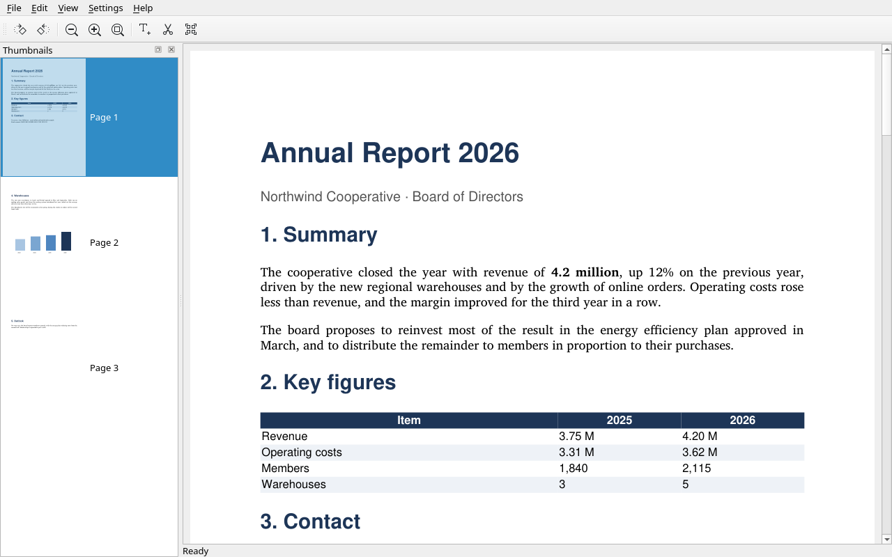
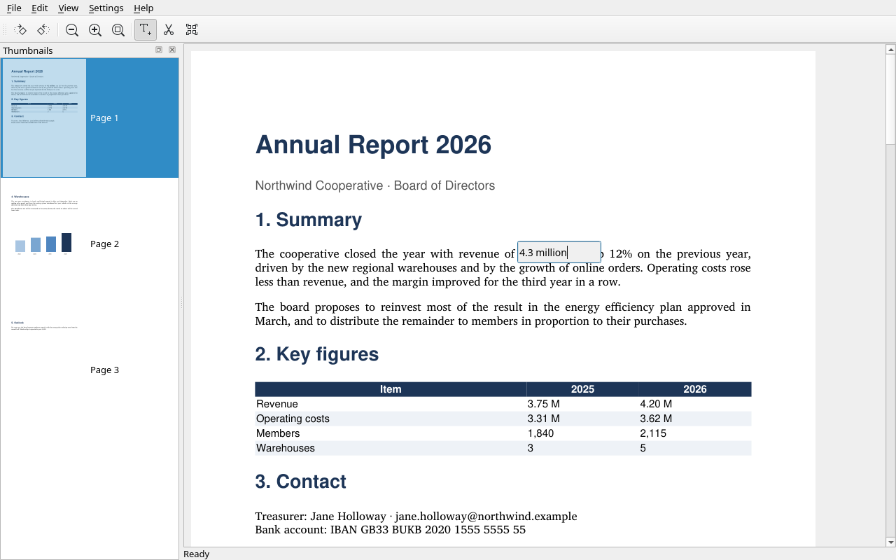
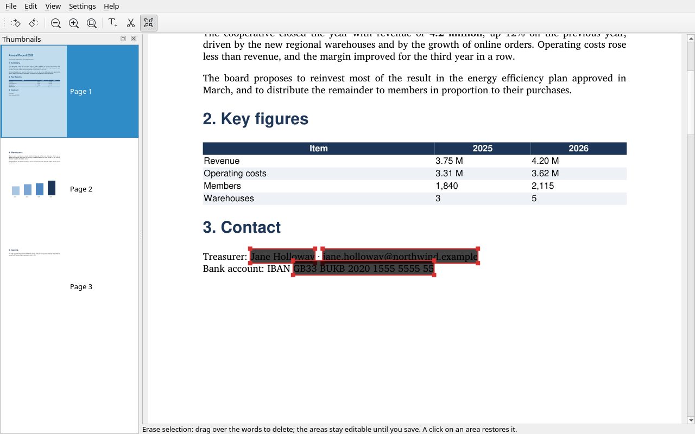
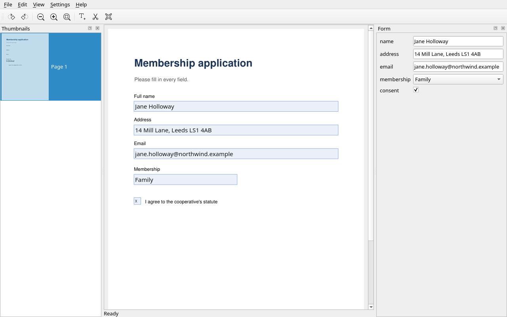
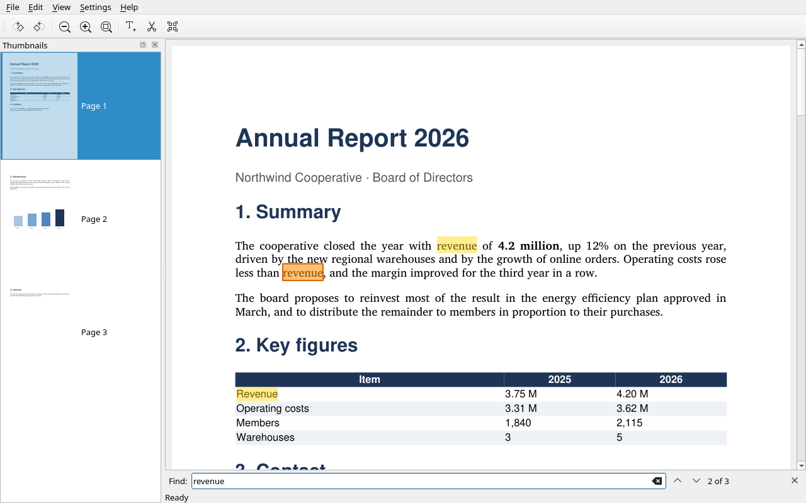

<p align="center">
  <a href="README.md"></a>
  <a href="README.en.md"></a>
  <a href="README.de.md"></a>
  <a href="README.es.md"></a>
</p>

# Plico

Un véritable éditeur PDF natif pour Linux, construit avec **Qt6** et
**PySide6**, qui utilise **PyMuPDF** pour lire et afficher les PDF et
**pikepdf** (qpdf) pour les compresser.

> Le fichier PDF n'est jamais touché tant que tu ne sauvegardes pas.

<p align="center">
  
  
  
</p>
<p align="center">
  
  
</p>

## Caractéristiques

- **Tourner, supprimer, réordonner** des pages (glisser-déposer dans la barre
  de miniatures)
- **Fusionner** un autre PDF : ses pages s'ajoutent à celles déjà ouvertes
  sans rien copier, parce que chaque page virtuelle sait à quel document
  source elle appartient. On peut aussi fusionner une image (un reçu
  photographié à la suite d'un PDF)
- **Créer un PDF à partir d'images** (_Fichier → Créer depuis des images…_,
  `Ctrl+Shift+N`) : photos et scans — PNG, JPEG, TIFF, BMP, GIF — deviennent
  une page chacun, dans l'ordre choisi. Un scan garde sa vraie taille (un A4
  à 300 dpi reste un A4), une photo de téléphone est ramenée à un A4 portrait,
  et les JPEG sont intégrés sans être recompressés
- **Extraire des pages** (diviser) dans un nouveau fichier avec une plage
  comme `1-3,5,8` — l'ordre tapé est conservé, donc ça sert aussi à
  réordonner
- **Paramètres** (*Paramètres → Configurer Plico…*, `Ctrl+Maj+,`) : la langue
  de l'interface — automatique, c'est-à-dire celle du système, ou l'une parmi
  italien, anglais, français, allemand et espagnol ; avec une langue du
  système que Plico n'a pas, on utilise l'anglais — et l'icône dans la zone de
  notification. Avec l'icône, on peut aussi faire que le X réduise Plico dans
  la zone de notification au lieu de le fermer : on quitte depuis
  *Fichier → Quitter* (`Ctrl+Q`) ou depuis « Quitter » dans le menu de
  l'icône. La langue change au prochain démarrage
- **Annuler/Refaire** complet, grâce à `QUndoStack`
- **Rendu asynchrone** dans un thread séparé — l'interface ne se bloque jamais
- **Rendu paresseux** : seules les pages visibles sont rendues, pas tout le
  document
- **Cache de pages à budget d'octets**, LRU pour les miniatures
- **Sauvegarde dans un fichier temporaire** : le PDF de départ n'est jamais
  touché. `Ctrl+S` sauvegarde sur le fichier ouvert (ou sur le dernier
  « Enregistrer sous »), `Ctrl+Shift+S` demande où ; le titre marque les
  modifications non sauvegardées avec `*`, et fermer ou ouvrir un autre
  fichier demande avant de les perdre. `Ctrl+W` (_Fichier → Fermer_) ferme le
  document en laissant la fenêtre ouverte
- **Sauvegarde compressée** à trois niveaux, plus « images seulement » et
  « pages à rééchantillonner » : le gain est le vrai, mesuré sur le fichier
  réellement écrit (et le niveau « léger » est sans perte)
- **Effacement réel** (en anglais _redaction_) : on dessine une zone sur les
  données à supprimer, ou on glisse sur les mots, et à la sauvegarde le texte
  est **retiré**, pas couvert — ce qui reste n'est plus copiable ni
  recherchable. Les champs de formulaire et les notes sous la zone partent
  aussi, tandis qu'effacer un mot ne touche pas les lignes au-dessus et
  en-dessous
- **Remplir les formulaires AcroForm** : on écrit dans la page, avec le
  panneau « Formulaire » en vue — texte, y compris multiligne, cases et listes
  déroulantes — et les valeurs arrivent dans le fichier à la sauvegarde, avec
  annuler/refaire
- **Édition minimale du texte** : un clic sur une ligne l'ouvre dans un
  éditeur sur la page ; l'ancien texte est retiré du fichier et le nouveau
  écrit au même endroit, avec la même taille, couleur et — quand il est
  installé — la même police. Les lignes voisines restent intactes même avec
  un interligne simple
- **OCR** (_Édition → Reconnaître le texte…_, `Ctrl+Shift+O`) : un scan
  devient **recherchable et sélectionnable** sans changer d'aspect — le texte
  reconnu est écrit sous l'image, invisible. On choisit quelles pages et en
  quelle langue, et chaque passage est une seule étape d'annulation
- **Signer** (_Fichier → Signer…_, `Ctrl+Shift+D`) : une signature **PAdES**
  avec ton propre certificat, invisible ou imprimée dans un cadre sur la page,
  et _Fichier → Vérifier les signatures…_ pour relire qui a signé et si le
  document a été touché après. Une deuxième signature s'ajoute à la première
  sans la casser

### Exigence d'acceptation

Un PDF de **300 pages** s'ouvre en moins de 2 secondes et reste réactif : à
l'ouverture seules 2 pages et ~12 miniatures sont rendues, pas 300. Le cache
des pages contient au plus une poignée d'entrées, quelle que soit la taille
du document. Couvert par
[`test_large_document_stays_responsive`](https://github.com/gradia64/Plico/blob/main/tests/test_integration.py).

## Architecture

```
plico/
├── pyproject.toml
└── src/plico/
    ├── app.py                 # point d'entrée
    ├── main_window.py         # MainWindow + câblage worker/model/view
    ├── model/
    │   ├── document.py        # DocumentModel, PageItem
    │   ├── commands.py        # QUndoCommand: RotatePage, DeletePage, AddRedaction, SetFieldValue…
    │   ├── redact.py          # rectangles de redaction, matrices de rotation
    │   ├── forms.py           # champs AcroForm : lecture, écriture, vidage
    │   ├── textedit.py        # édition d'une ligne de texte : span, vérification, réécriture
    │   ├── ocr.py             # reconnaissance avec Tesseract, couche invisible, langues
    │   ├── sign.py            # signature PAdES avec pyHanko et relecture des signatures
    │   ├── images.py          # d'images à PDF : A4, dpi, EXIF, JPEG intacts
    │   ├── save.py            # save_as(), save_compressed(), extract_pages()
    │   ├── assemble.py        # pages de plusieurs PDF, champs de formulaire intacts
    │   └── optimize.py        # niveaux de compression, optimize_in_place()
    ├── rendering/
    │   └── worker.py          # RenderWorker dans QThread
    └── widgets/
        ├── page_view.py       # QScrollArea : rendu, ajustement largeur, HiDPI, redaction, champs
        ├── thumbnail_bar.py   # QListView + modèle + cache, chargement paresseux
        ├── form_panel.py      # panneau « Formulaire » : un éditeur par champ
        ├── ocr.py             # dialogue langues/pages et tâche de reconnaissance
        ├── sign.py            # dialogues de signature et de vérification des signatures
        └── compress.py        # dialogue des options, format_size, tâche
```

### Concept clé

Le modèle ne modifie jamais le PDF : c'est seulement une liste de **pages
virtuelles**. Chaque page virtuelle est une paire `(source_id, source_index)`
plus la rotation choisie par l'utilisateur. Tout découle de cette liste :

- **annuler/refaire** : manipule une liste Python, pas le fichier
- **fusion** : ajouter un PDF ne fait qu'ajouter des pages qui pointent vers
  un second `source_id` ; aucune page n'est copiée
- **rendu** : le worker ouvre les documents source en lecture seule, à la
  demande, et rend sans se coordonner avec le modèle
- **sauvegarde** : matérialise la liste en copiant chaque source une seule
  fois puis en plaçant les pages dans l'ordre dans le fichier de sortie —
  copier deux fois depuis la même source renommerait ou perdrait les champs
  de formulaire

L'identité d'une page est toujours la paire `(source_id, source_index)`,
jamais `source_index` seul : après une fusion deux pages ont régulièrement le
même indice dans des documents différents, et n'en utiliser qu'un les ferait
s'effondrer en une seule (mauvaise miniature, pixmap réutilisé du cache par
erreur).

Les vues **observent le modèle** : `PageView` et `ThumbnailBar` se connectent
aux signaux `changed` / `page_changed`, de sorte qu'un annuler se reflète
automatiquement sur les deux sans que la fenêtre ait à se souvenir de les
rafraîchir.

### Rotation : deux valeurs, pas une

`base_rotation` est le `/Rotate` original du PDF, `rotation` est le décalage
choisi par l'utilisateur. Le rendu compose les deux, la sauvegarde écrit la
somme (`total_rotation`). Les clés de cache incluent la rotation, sinon une
page tournée réutiliserait la miniature précédente.

### Sauvegarder sur le fichier ouvert

Sauvegarder sur le même fichier que celui qu'on lit est permis : le nouveau
document est écrit dans un fichier temporaire dans le même dossier et ne
remplace l'original qu'à la fin. Une erreur d'écriture ne détruit donc
jamais le fichier de l'utilisateur.

Après une fusion il y a plus d'une source, donc la vérification couvre
**toutes** les sources : sauvegarder sur l'un quelconque des PDFs ouverts
passe par le fichier temporaire, parce que PyMuPDF ne peut pas écrire dans
un document qu'il est en train de lire.

Après une sauvegarde sur le fichier ouvert, Plico **rouvre** le fichier
sauvegardé : c'est celui-là le document, maintenant, avec suppressions,
rotations et redactions déjà dedans. C'est pourquoi les modifications faites
jusque-là ne peuvent plus être annulées. Extraire des pages sur un fichier
ouvert, en revanche, n'est pas permis.

### Compression : où se gagne vraiment

« Sauvegarder compressé » (`Ctrl+Shift+C`) écrit une copie plus petite du
document virtuel — donc il respecte suppressions, réordonnancements et
rotations — et laisse intacts les PDFs de départ.

| Niveau | Ce qu'il fait | Sans perte ? |
| --- | --- | --- |
| **Léger** | fusionne les content stream fragmentés, compacte la structure | oui |
| **Moyen** | comme ci-dessus, plus images au-dessus de 200 dpi ramenées à 150 (qualité 80) | non |
| **Fort** | images au-dessus de 150 dpi ramenées à 96 (qualité 60) | non |

Le plus gros gain ne vient pas des images mais du `clean` de mutool : un PDF
qui a subi copies et modifications traîne des centaines de content stream
minuscules, et les fusionner vaut, sur un document de texte, 188 Ko → 12 Ko
(6 %). Sur un scan la structure n'a rien à donner, et seul compte le travail
sur les images (un JPEG de 3,4 Mo sur 3 pages reste à 100 % avec « léger »,
tombe à 52 % avec « moyen » et à 36 % avec « fort »).

Le niveau dit _combien_, pas _quoi_ : sous la liste déroulante il y a deux
choix de plus. **« Images seulement »** saute la recompaction du fichier —
utile sur un scan, où le gain est dans les images, tandis que sur un
document de texte seul il ne gagne rien et le programme le dit au lieu
d'écrire une copie identique. **« Pages à rééchantillonner »** laisse intactes
les images des autres pages, utile quand des scans lourds côtoient des pages
de texte. Il y a un cas où on ne gagne rien : si deux pages partagent la
même image, compresser une seule obligerait l'autre à avoir sa propre copie,
et le fichier grossirait — alors rien n'est écrit, et le message l'explique.

Le gain n'est pas une estimation : le fichier compressé est vraiment écrit
(à côté de la destination) et ce n'est qu'après que le programme dit combien
il pèse, en l'adoptant seulement s'il a gagné.

La compression tourne dans un thread séparé, donc la fenêtre reste réactive
même sur les gros fichiers.

### Redaction : le texte s'en va vraiment

`Ctrl+Shift+X` (_Édition → Redacter une zone_) active l'outil : on glisse un
rectangle sur les données à supprimer, un clic sec sur une zone l'annule,
`Esc` sort. Une zone déjà dessinée se **corrige sans la refaire** : les
coins la redimensionnent, le centre la déplace. Les zones restent
**modifiables jusqu'à la sauvegarde** — ce sont des commandes d'annulation
comme les autres (`Ctrl+Z`) et l'aperçu sombre sur la page montre exactement
où elles finiront.

À la sauvegarde PyMuPDF réécrit les content stream et **retire** les mots
qui tombent dans la zone : dans le fichier ne restent ni le texte ni l'image
sous le rectangle. Un rectangle noir dessiné par-dessus — ce que font
pas mal d'outils — laisserait le secret copiable et recherchable. Avec le
contenu partent aussi les **notes** et les **champs de formulaire** que la
zone touche : un champ rempli avec un nom resterait autrement dans le
fichier, valeur comprise.

`Ctrl+Shift+F` (_Édition → Redacter un mot…_) cherche au contraire un mot
sur **toutes** les pages et marque chaque occurrence d'un coup, comme une
seule étape d'annulation. Il cherche aussi dans le texte reconnu par l'OCR,
même avant de sauvegarder.

`Ctrl+Shift+L` (_Édition → Redacter la sélection_) est la troisième voie,
celle qu'attend qui a utilisé un éditeur : on glisse sur les mots à
supprimer et ils sont marqués **en entier**, un par un, avec une marque aussi
serrée que le mot. Le glissement est un seul geste, donc un `Ctrl+Z` défait
toute la sélection ; glisser là où il n'y a pas de texte ne laisse rien ; un
clic sur une marque la retire, comme pour une zone, et une marque se déplace
et se redimensionne aussi. Ça marche aussi sur les mots lus par l'OCR.

Quatre choses à savoir :

- les mots sont pris **entiers** (une marque au milieu d'un mot ne cacherait
  rien), et l'unité minimale est le mot, pas la lettre ;
- une marque de mot — de _Redacter un mot_ ou de _Redacter la sélection_ —
  retire le texte de **sa ligne seulement** : avec un interligne simple les
  lettres des lignes au-dessus et en-dessous touchent son cadre, et restent
  où elles sont. Une zone **dessinée**, en revanche, supprime tout ce
  qu'elle touche, parce que c'est ce qui a été dessiné, et il en va de même
  pour une marque de mot qui a été déplacée ou redimensionnée ;
- `apply_redactions()` supprime aussi la graphique vectorielle qui touche le
  rectangle, donc une bordure ou un tableau à cheval sur la marque peuvent
  disparaître ;
- un clic sur une marque la retire même si la souris a bougé d'un pixel :
  c'est un clic, pas un glissement, et `Ctrl+Z` la remet exactement où elle
  était.

Les métadonnées du PDF, en revanche, ne sont pas un risque : le fichier de
sortie est reconstruit à partir des pages seules, donc `/Info`, le XMP et
les pièces jointes n'y arrivent jamais.

### Édition du texte : une ligne à la fois

`Ctrl+Shift+T` (_Édition → Éditer le texte_) active l'outil : un clic sur
une ligne **déjà présente** dans le PDF ouvre un petit éditeur par-dessus,
**Entrée** confirme, **Échap** annule. Un clic là où il n'y a pas de texte,
ou sur une page qui n'est qu'une image (un scan), le dit à côté du pointeur.
L'outil corrige le texte qui est là : il n'ajoute pas de texte nouveau dans
un vide. La correction se voit tout de suite sur la page et c'est une
commande comme les autres (`Ctrl+Z`) ; elle n'entre dans le fichier qu'à la
sauvegarde, où l'ancien texte est **retiré** du content stream — pas couvert
— et le nouveau écrit au même endroit. Le fond, les bordures de tableaux et
le texte à côté restent, ainsi que les lignes au-dessus et en-dessous :
l'ancien texte est retiré d'une bande autour de la ligne, pas de son cadre,
qui avec un interligne simple toucherait aussi les voisines.

C'est une édition _minimale_, et elle le dit : un texte qui ne tient pas
dans l'espace libre (jusqu'au bord de la cellule, au mot suivant ou à la
marge de la page, même sur une page tournée) est rétréci jusqu'à 80 % et
au-delà refusé, avec le motif dans la barre d'état. Le texte vertical et les
polices Type3 ne sont pas édités. La police est celle du document quand on
peut la réutiliser, sinon la même installée sur le système, sinon un sosie
(serif, sans ou monospace) avec le même style.

### Formulaires : remplir le PDF, pas seulement le lire

On remplit **sur la page** : un clic sur un champ de texte ouvre l'éditeur
où se trouve le champ, une case se coche là où on l'a cliquée, un bouton
radio choisit la réponse qu'il représente. Le panneau **Formulaire** (à
droite) liste les champs de la page en vue et reste la voie pour ceux qui ne
s'écrivent pas sur la page — listes déroulantes, texte multiligne, champs en
lecture seule. Les valeurs restent **modifiables jusqu'à la sauvegarde** et
passent par le même annuler/refaire que le reste (`Ctrl+Z`).

Un champ AcroForm n'est pas du contenu PDF mais une annotation avec une
valeur, et Plico le traite comme tel : les **descriptions** des champs
viennent de la source, les **valeurs** qu'on écrit vivent dans le modèle, et
`save.py` les applique pendant la matérialisation des pages — avant les
redactions, donc une redaction sur un champ l'emporte. La valeur dessinée
sur la page est celle du modèle, c'est-à-dire celle qui _sera_ dans le
fichier.

Un champ n'est écrit **que si on le touche** : un jamais ouvert conserve la
valeur qu'il avait dans la source, ce qui n'est pas la même chose que le
vider. Un groupe de boutons radio est **une seule question** — le panneau
l'affiche comme une liste déroulante avec les réponses — et on peut aussi
choisir en cliquant sur l'un dans la page. Les signatures appartiennent à
_Fichier → Signer…_.

### OCR : rendre un scan recherchable

_Édition → Reconnaître le texte…_ (`Ctrl+Shift+O`) lit les pages choisies
avec Tesseract et écrit sous l'image une **couche de texte invisible** (mode
de rendu 3). La page a l'air identique, mais le texte peut être
sélectionné, copié, recherché avec `Ctrl+F` — et _Redacter un mot_
(`Ctrl+Shift+F`) le trouve enfin, chose impossible sur un scan non marqué. Il
le trouve tout de suite, pas seulement après avoir sauvegardé : la couche
entre dans le fichier à la sauvegarde, mais la recherche regarde aussi les
mots juste reconnus.

La reconnaissance coûte (environ une demi-seconde par page A4 à 300 dpi), donc
elle n'est pas automatique : on écrit les pages comme dans *Extraire des
pages* (`3`, `4-8`, `1-3,5` ; toutes sont proposées à l'ouverture) et on choisit
la langue, avec celle de l'interface et l'anglais ensemble comme proposition. Elle tourne dans le pool de threads
avec une barre de progression annulable — pendant qu'elle tourne la fenêtre
n'accepte aucune modification des pages qu'elle lit — et chaque passage est
**une seule** étape d'annulation : un `Ctrl+Z` retire la couche de toutes
les pages d'un coup.

La police de la couche est une des Base-14 et n'est pas intégrée, donc
rendre un scan recherchable n'ajoute pas un octet. Les mots déjà présents
dans le PDF ne sont pas réécrits : une page moitié texte et moitié scan ne
se retrouve pas avec le texte doublé.

Les données de langue (`*.traineddata`) vont dans
`~/.local/share/plico/tessdata/`, sans root ; le Flatpak apporte déjà
l'italien, l'anglais, l'espagnol, le français et l'allemand, et propose la
langue de l'interface avec l'anglais. La bibliothèque Tesseract doit être
présente : dans le Flatpak elle est compilée dedans (voir Flatpak), sur une
distribution c'est le paquet `tesseract` / `libtesseract`.

### Signature : un PDF signé, pas un tampon

_Fichier → Signer…_ (`Ctrl+Shift+D`) signe le document avec un certificat
PKCS#12 (`.p12` / `.pfx`) et produit une signature **PAdES** — le profil
de signature PDF que les lecteurs européens reconnaissent. On choisit si la
signature reste invisible ou apparaît dans un cadre en bas à droite avec nom,
date et motif : le cadre est du contenu de page, donc on ne peut pas l'enlever
sans casser la signature.

Quatre choses que cette implémentation fait et une qu'elle ne fait pas :

- **La signature est le dernier octet du fichier.** D'abord le document est
  matérialisé (avec tous les champs remplis, le texte réécrit, les
  redactions appliquées, les pages tournées), puis on signe. L'ordre inverse
  produirait une signature couvrant une version du document différente de
  celle que l'utilisateur voit.
- **Signer adopte le fichier signé.** Après _Signer…_ la session pointe sur
  le nouveau fichier, parce que continuer à travailler sur la liste de pages
  qui l'a généré ferait perdre la signature au prochain sauvegarde.
- **Une deuxième signature s'ajoute à la première.** Si le document signé
  n'a pas de modifications non sauvegardées, la nouvelle signature s'ajoute au
  fichier tel quel (une mise à jour incrémentale) et la première reste
  valide. Avec des modifications non sauvegardées il faut réécrire le fichier
  et la signature précédente ne couvrirait plus rien, donc elle est retirée et
  il ne reste que la nouvelle : le programme le dit avant et demande si on
  continue.
- **Sauvegarder sur un fichier signé demande d'abord.** Une sauvegarde
  normale réécrit le PDF de zéro : la signature n'y est plus, et le fichier
  sauvegardé n'en porte pas de cassée à sa place. Le programme le dit et
  attend un « oui », au lieu de le faire et basta.
- **Il ne décide pas de qui se fier.** Plico n'embarque aucun magasin
  d'autorités : une signature intègre et valide d'un certificat inconnu est
  affichée comme « intègre, mais le certificat n'est pas parmi ceux que tu
  considères de confiance ». On ajoute les certificats en qui on a confiance
  un par un (fichiers `.pem`) et ils restent dans `QSettings`.

_Fichier → Vérifier les signatures…_ relit les signatures du **fichier sur
disque** et distingue les cas qui comptent : signature intègre et de
confiance ; intègre mais d'un certificat inconnu (ambre, pas rouge : c'est
quand même une vraie signature) ; intègre mais sur un document **modifié
après signature** — valide seulement pour la version signée ; signature
**cassée**, c'est-à-dire que le contenu qu'elle couvrait a changé (rouge,
toujours, même si le fichier a des révisions ultérieures) ; signature non
valide ou certificat expiré. Un module qui n'a jamais été signé n'est pas
pris pour un document signé.

### Intégration au bureau (KDE)

- **Icônes du thème** (`QIcon.fromTheme` : `document-open`,
  `document-save-as`, `edit-undo`, `object-rotate-right`, `zoom-in`, …) :
  aucun actif graphique dans le paquet. Si le thème ne fournit pas l'icône,
  l'action reste sans icône au lieu d'afficher un carré vide.
- **Cinq langues** : italien, anglais, espagnol, français et allemand, y
  compris dans les boutons des dialogues standard de Qt et dans les métadonnées
  du store (voir « Traduire Plico »).
- **État de la session dans `QSettings`** (`~/.config/Plico/plico.conf`) :
  géométrie de la fenêtre, disposition des panneaux et de la barre
  d'outils, et facteur de zoom.

## Prérequis

- Python ≥ 3.11
- PySide6 ≥ 6.7
- PyMuPDF (pymupdf) ≥ 1.24.3
- pikepdf ≥ 9 (compression ciblée)
- pyHanko ≥ 0.37 (signature PAdES ; apporte cryptographie et validation)
- Tesseract (bibliothèque, 4 ou 5) et au moins un fichier de données de
  langue pour l'OCR — le Flatpak apporte les deux

## Installation

Chaque [release](https://github.com/gradia64/Plico/releases) propose ces
paquets pour Linux x86_64, construits depuis le tag signé :

- **AppImage** (`Plico-X.Y.Z-x86_64.AppImage`) : un seul fichier, avec dedans
  Python, Qt, PyMuPDF et les données de langue de l'OCR. On le rend
  exécutable (`chmod +x Plico-X.Y.Z-x86_64.AppImage`) et on le lance. Requiert
  glibc 2.34 ou plus récent : Debian 12, Ubuntu 22.04, Fedora 35 ou plus.
- **Debian et Ubuntu** (`plico_X.Y.Z_amd64.deb`) : le même contenu que
  l'AppImage, installé dans `/opt/plico` avec le menu et l'icône ;
  `sudo apt install ./plico_X.Y.Z_amd64.deb`. Mêmes exigences que l'AppImage ;
  ne se met pas à jour tout seul.
- **Flatpak** (`Plico-X.Y.Z-x86_64.flatpak`) : `flatpak install --user
  Plico-X.Y.Z-x86_64.flatpak` télécharge depuis Flathub le runtime KDE dont
  il a besoin. Ne se met pas à jour tout seul : la nouvelle version
  s'installe de la même manière.
- **Arch Linux** : le paquet `plico` de l'AUR (`paru -S plico`, ou un autre
  helper) se construit depuis le tag signé, que `makepkg` vérifie avec la clé
  de release ; le paquet déjà construit est aussi parmi les fichiers joints de
  la release (`pacman -U plico-X.Y.Z-1-any.pkg.tar.zst`).

À côté se trouvent `SHA256SUMS` et, pour chaque fichier, une attestation de
provenance GitHub : `gh attestation verify Plico-X.Y.Z-x86_64.AppImage -R
gradia64/Plico` vérifie que le fichier a été produit par la CI de ce dépôt
depuis ce tag.

Depuis les sources, pour le développement :

```
pip install -e ".[dev]"
```

Le point d'entrée accepte les fichiers à ouvrir, comme on l'attend d'une app
de bureau :

```
plico relazione.pdf              # ouvre
plico a.pdf b.pdf                # ouvre a.pdf et y fusionne b.pdf
plico ricevuta.jpg a.pdf         # crée un document à partir de la photo et y fusionne a.pdf
```

Il accepte aussi les URL `file:///…` que passent certains lanceurs. Le
fichier `.desktop` demande de toute façon des chemins (`Exec=plico %F`).

## Flatpak

L'empaquetage est dans `flatpak/` et est pensé pour être publié sur Flathub.

| Fichier | Rôle |
| --- | --- |
| `io.github.gradia64.plico.json` | manifeste de l'application |
| `python3-pymupdf.json` | module pour PyMuPDF, avec wheel et `sha256` fixés |
| `python3-pikepdf.json` | module pour pikepdf, avec wheel et `sha256` fixés |
| `python3-pyhanko.json` | module pour pyHanko et ses dépendances, toujours depuis des wheels |
| `io.github.gradia64.plico.desktop` | lanceur (enregistre `application/pdf`, reçoit les chemins avec `%F`) |
| `io.github.gradia64.plico.metainfo.xml` | métadonnées AppStream |
| `io.github.gradia64.plico.svg` | icône |

Huit choix non évidents :

- **`base: io.qt.PySide.BaseApp`** au lieu d'installer PySide6 avec pip. La
  BaseApp de Flathub contient déjà PySide6 compilé et aligné sur le Qt de
  `org.kde.Platform`, donc le bundle ne duplique pas Qt ni ne risque
  d'écraser la version du runtime. C'est pourquoi l'installation de
  l'application utilise `--no-deps` : PySide6 vient du runtime, PyMuPDF de
  son module, et pip ne doit même pas essayer de télécharger PySide6 depuis
  PyPI.
- **PyMuPDF depuis un wheel `manylinux`** (`cp310-abi3`, valide pour tout
  Python ≥ 3.10, donc aussi pour le 3.13 du runtime) et non depuis les
  sources : compiler MuPDF dans le manifeste demanderait `swig` et plusieurs
  minutes de build.
- **pikepdf depuis un wheel `cp313`** (l'interpréteur de la BaseApp, qui
  n'est pas celui du venv) **installé avec `--no-deps`** : pikepdf déclare
  `Pillow`, `lxml` et `packaging`, mais `open()` et `save()` ne les
  importent pas, et `packaging` est déjà dans la BaseApp. S'il fallait les API
  sur les images ou le support PDF/A, il faudrait aussi ajouter leurs wheels.
- **pyHanko depuis des wheels, dans un seul module**
  (`python3-pyhanko.json`) : pyHanko entraîne `cryptography`, `asn1crypto`,
  `aiohttp`, `lxml` et une dizaine d'autres dépendances, toutes pure Python
  ou avec un wheel `manylinux` pour le 3.13 de la BaseApp, donc elles
  s'installent d'un coup avec `--no-index --no-deps`. Ce sont les vingt
  fichiers listés dans le module, chacun avec son `sha256` : la signature
  numérique est la partie du programme où « à peu près cette version » n'est
  pas une réponse acceptable.
- **Les traductions sont compilées pendant le build** : `lrelease` n'existe
  que dans le SDK de Qt, pas dans le runtime, et les `.qm` sont les seuls
  fichiers nécessaires à l'exécution. Le module `plico` installe les `.ts`
  avec le paquet puis les compile dans `/app/share/plico/translations`, de
  sorte que le compilateur n'atterrit pas dans le bundle.
- **`cleanup-commands: /app/cleanup-BaseApp.sh`**, requis par la BaseApp.
- **Aucun accès à la home** (pas de `--filesystem`) : chaque fichier passe
  par le sélecteur de fichiers du portail
  (`org.freedesktop.portal.FileChooser`), que Qt utilise de lui-même dans
  Flatpak. Plico voit le document comme
  `/run/user/<uid>/doc/<id>/nom.pdf` et le lit et l'écrit là, sauvegarde
  atomique comprise (le temporaire dans le même dossier et `os.replace`
  fonctionnent aussi dans le document portal) ; pour proposer un chemin dans
  les dialogues il utilise plutôt le vrai, que le portail expose dans
  l'attribut étendu `user.document-portal.host-path`. Le lanceur utilise
  `%F`, donc un double-clic arrive déjà comme chemin exporté dans le portail.
- **`--talk-name=org.kde.StatusNotifierWatcher`**, la seule permission D-Bus :
  sans elle, dans la sandbox la zone de notification n'existe pas et l'icône
  des Paramètres n'apparaît jamais (testé sur Plasma). Qt enregistre l'icône
  sous son nom unique sur le bus, donc il n'y a pas d'autre nom à posséder.
  L'icône est facultative et désactivée par défaut.

Construire et installer pour ton propre utilisateur :

```
# une fois : builder, SDK et BaseApp
flatpak remote-add --user --if-not-exists flathub \
    https://dl.flathub.org/repo/flathub.flatpakrepo
flatpak install --user -y flathub org.flatpak.Builder//stable \
    org.kde.Sdk//6.11 io.qt.PySide.BaseApp//6.11

# build + install. Le cache est HORS du projet : build-dir/ et
# .flatpak-builder/ dans l'arbre sont trouvés par les recherches globales et
# contiennent des copies des sources.
flatpak run org.flatpak.Builder --force-clean --user --install \
    --install-deps-from=flathub \
    --state-dir="$HOME/.cache/plico-flatpak/state" \
    "$HOME/.cache/plico-flatpak/build" \
    flatpak/io.github.gradia64.plico.json

flatpak run io.github.gradia64.plico
```

Les **captures d'écran** du store sont dans `flatpak/screenshots/` et sont
produites par `tools/screenshots.py` depuis la vraie app ; dans le metainfo
elles pointent sur le tag de la dernière version, et chaque version les déplace
sur son nouveau tag.

### Publier

Flathub ne construit pas depuis le checkout mais depuis un tag git, fixé
aussi à son commit. Le manifeste dans `flatpak/` reste celui de
développement (`type: dir`), et celui à envoyer est généré par
`tools/flathub_manifest.py` **depuis le tag**. Avant d'écrire il vérifie
que :

- le tag est `v` + la version de `pyproject.toml` + le dernier `<release>`
  de la metainfo ;
- les captures de la metainfo pointent sur le tag et non sur `main` ;
- le tag est annoté, signé par une clé de `.github/allowed_signers` et
  présent sur `origin` avec le même objet.

Les tags se signent avec la clé **SSH** (pas de PGP à garder). Une fois par
checkout :

```
git config gpg.format ssh
git config user.signingkey ~/.ssh/id_ed25519.pub
git config tag.gpgSign true
git config gpg.ssh.allowedSignersFile "$PWD/.github/allowed_signers"
```

Pour que GitHub affiche le tag comme « Verified », la même clé doit aussi
être enregistrée comme _signing key_ du compte (Settings → SSH and GPG keys
→ New SSH key → Signing key).

À chaque publication :

```
# 1. version dans pyproject.toml, nouveau <release> et URL des captures
#    (…/Plico/vX.Y.Z/flatpak/screenshots/…) dans la metainfo ; commit et push
# 2. tag signé, vérifié, publié
git tag -s v0.1.0 -m "Plico 0.1.0"
git tag -v v0.1.0
git push origin v0.1.0
# 3. le manifeste pour Flathub, avec les modules qu'il inclut
python tools/flathub_manifest.py v0.1.0 ~/flathub/io.github.gradia64.plico
```

`--allow-unsigned --offline` fait un essai à blanc sur un tag local non
signé.

## Développement

```
# tests (sans display, grâce à QT_QPA_PLATFORM=offscreen).
# NB : pytest n'est pas dans .venv/bin, donc on passe par python -m
QT_QPA_PLATFORM=offscreen .venv/bin/python -m pytest -q

# lint + types
ruff check src/ tests/ tools/
mypy src/plico

# lancement
plico            # ou : python -m plico.app

# captures pour le store (flatpak/screenshots), en anglais ou dans une autre langue
QT_QPA_PLATFORM=offscreen python tools/screenshots.py [it|es|fr|de]
```

La **CI** (GitHub Actions, `.github/workflows/`) fait la même chose à chaque
push et pull request : `ci.yml` exécute tests, `ruff` et `mypy` sur Python
3.11 à 3.14 et valide metainfo, `.desktop` et manifeste ; `flatpak.yml`,
sur `main` et à la demande depuis l'onglet Actions, construit le vrai
Flatpak, le passe au linter de Flathub (`flatpak-builder-lint`) et laisse le
paquet `plico.flatpak` parmi les artefacts de la run, installable avec
`flatpak install --user plico.flatpak`.

### Traduire Plico

Plico parle **italien**, **anglais**, **espagnol**, **français** et
**allemand** : il suit la langue du système, et une langue qu'il ne connaît
pas reçoit l'anglais. Les chaînes sont en italien dans le code ; les
catalogues des autres langues sont dans
`src/plico/translations/plico_{en,es,fr,de}.ts` et se modifient avec Qt
Linguist ou un éditeur de texte. Une langue nouvelle est un fichier
`plico_xx.ts` de plus : on le crée avec `pylupdate6`, on le traduit, et on
l'ajoute à `LANGUAGES` dans `tests/test_translations.py`, aux `<languages>`
du metainfo et aux entrées `[xx]` du `.desktop`.

`pylupdate6` vient avec PyQt6 (`pip install PyQt6` dans le venv suffit, seul
l'outil est nécessaire) : sans lui, `tests/test_i18n.py` saute justement le
contrôle qui avertit quand une chaîne nouvelle manque au catalogue.

```
# 1. réextraire les chaînes après avoir touché au code,
#    dans les quatre catalogues
for l in en es fr de; do
    pylupdate6 -no-obsolete src/plico -ts src/plico/translations/plico_$l.ts
done

# 2. compiler : pyside6-lrelease vient avec PySide6 (ou lrelease du SDK)
pyside6-lrelease src/plico/translations/plico_de.ts -qm /tmp/plico_de.qm

# 3. l'essayer sans rien installer
LANG=de_DE.UTF-8 PLICO_TRANSLATIONS=/tmp plico
```

`tests/test_i18n.py` vérifie que les catalogues sont ceux que produisent les
sources, afin qu'aucune chaîne nouvelle ne reste dehors ;
`tests/test_translations.py` que chaque langue soit complète, conserve les
marqueurs de position (`{0}`) et ne donne pas le même raccourci à deux
entrées d'un menu.

## Licence

GPL v3 — voir [LICENSE](https://github.com/gradia64/Plico/blob/main/LICENSE).

## About

Un véritable éditeur PDF natif pour Linux : fusionner, diviser, tourner, réordonner, sauvegarder. Qt6 + PySide6 + PyMuPDF.

### Topics

[desktop-application](https://github.com/topics/desktop-application) [flatpak](https://github.com/topics/flatpak) [kde](https://github.com/topics/kde) [linux](https://github.com/topics/linux) [pdf](https://github.com/topics/pdf) [pdf-editor](https://github.com/topics/pdf-editor) [pymupdf](https://github.com/topics/pymupdf) [pyside6](https://github.com/topics/pyside6) [python](https://github.com/topics/python) [qt6](https://github.com/topics/qt6)

### Resources

[Readme](https://github.com/gradia64/Plico#readme-ov-file)

[GPL-3.0 license](https://github.com/gradia64/Plico#GPL-3.0-1-ov-file)

[Activity](https://github.com/gradia64/Plico/activity)